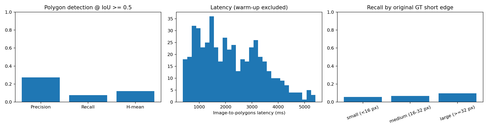

# PP-OCRv6_small_det trên VinText test

Đã benchmark thực tế toàn bộ 500 ảnh ngày 02/11/2026, không có lỗi suy luận. Model có thể bao được nhiều vùng chữ nhưng chưa phù hợp với cách chia nhãn từng từ của VinText: H-mean theo phép ghép polygon một-một chỉ đạt **12,04%**. Overlay xác nhận nhiều prediction bao cả dòng thay vì từng từ. Cần xử lý sự khác biệt này trước khi quy kết kết quả thấp cho khả năng phát hiện chữ tiếng Việt.

## Dữ liệu và protocol

- Nguồn local: `data/raw/datasets/vintext/test/`, 500 ảnh và 500 file nhãn.
- 12.253 polygon hợp lệ: 10.086 vùng được chấm, 2.167 vùng `###` bỏ qua.
- Không thay đổi ảnh hoặc nhãn gốc. Chuẩn hóa/resize do framework của model thực hiện.
- IoU polygon >= 0,5; ghép một-một tối đa số cặp hợp lệ, sau đó tối ưu tổng IoU.
- Bỏ prediction nếu diện tích chồng lên một vùng ignored lớn hơn 50% diện tích prediction.
- Tổng hợp micro trên toàn tập. Đây là evaluator chẩn đoán nội bộ, **chưa phải kết quả evaluator chính thức VinText**.
- Không đánh giá CER/WER: model detection chỉ định vị chữ, không đọc nội dung.

## Kết quả

| Chỉ số | Kết quả |
| --- | ---: |
| Precision | 27,30% |
| Recall | 7,72% |
| H-mean | 12,04% |
| TP / FP / FN | 779 / 2.074 / 9.307 |
| Ảnh lỗi suy luận | 0 / 500 |
| Latency p50 | 2.052,31 ms |
| Latency p95 | 4.289,15 ms |
| Thông lượng suy luận tuần tự | 0,451 ảnh/giây |
| Wall time benchmark | 1.129,27 giây, khoảng 18,82 phút |
| Nạp model từ cache | 12,69 giây, ghi riêng |
| RSS đỉnh lấy mẫu sau khi nạp model | 350,25 MiB |

[Biểu đồ SVG để xuất/chia sẻ](figures/ppocrv6_small_det_vintext.svg).

Latency tính từ ảnh BGR trong RAM đến polygon, gồm tiền xử lý, suy luận, hậu xử lý và adapter; không gồm đọc ảnh, chấm điểm, ghi file, vẽ biểu đồ hoặc nạp model. Warm-up 5 lần được loại khỏi latency. Wall time có thêm đọc ảnh, chấm điểm và ghi JSONL. RSS được lấy mẫu mỗi 50 ms, không phải VRAM hoặc đỉnh bộ nhớ chính xác.

## Insight và hướng cải thiện

### 1. Khác biệt giữa nhãn từng từ và box theo dòng là vấn đề nổi bật

Có **1.966 prediction** phủ hơn 50% diện tích của ít nhất hai GT. Đồng thời **8.667/10.086 GT (85,93%)** được một prediction bất kỳ phủ hơn 50% diện tích, cao hơn nhiều recall IoU một-một 7,72%. Độ phủ này chỉ dùng chẩn đoán; một box quá rộng cũng có thể đạt độ phủ cao, nên không thay thế recall.

Đã xem trực tiếp overlay của `im1501`, `im1524`, `im1786`: nhiều từ có box GT riêng nhưng model bao cả dòng. Ví dụ các dòng trên biển quảng cáo và băng rôn vẫn được định vị tổng thể, nhưng không ghép được từng từ. Một số vật thể/trang trí cũng bị phát hiện nhầm.

**Ưu tiên:** xác định đầu ra sản phẩm cần từng từ hay từng dòng. Nếu cần từng từ, chuẩn bị dữ liệu train/validation theo cùng đơn vị nhãn và fine-tuning detector; thử tham số hậu xử lý trên validation trước. Nếu cần từng dòng, xây bộ nhãn dòng riêng với quy tắc rõ ràng và báo cáo thành một protocol khác. Không sửa nhãn test chỉ để tăng điểm hiện tại.

### 2. Chữ nhỏ khó hơn, nhưng tăng độ phân giải chưa giải quyết việc gộp từ

| Cạnh ngắn polygon GT trên ảnh gốc | Khớp / tổng | Recall IoU |
| --- | ---: | ---: |
| <16 px | 140 / 2.470 | 5,67% |
| 16 đến <32 px | 220 / 3.251 | 6,77% |
| >=32 px | 419 / 4.365 | 9,60% |

Có **5.100 GT** có best IoU trong [0,1; 0,5): prediction có chồng lên vùng chữ nhưng chưa đạt ngưỡng hình học. Nhóm này có thể chứa gộp/tách vùng hoặc box lệch, không chỉ chữ nhỏ.

**Thử trên validation:** tăng `limit_side_len` với `limit_type` cố định, so sánh recall nhóm chữ nhỏ và p95. Xem riêng các GT có IoU gần ngưỡng để điều chỉnh `unclip_ratio`; cân nhắc `box_thresh`/`thresh` khi có bằng chứng về FP/FN. Không đảm bảo giảm unclip sẽ tách được những từ đã gộp trong bản đồ xác suất.

### 3. Tốc độ CPU chưa được tối ưu

p95 khoảng **2,09 lần p50**; baseline này là CPU, batch size 1, 4 thread và `enable_mkldnn=false`. Không dùng số liệu này để kết luận tốc độ tối đa của model hoặc so với thời gian GPU trong tài liệu chính thức.

**Thử nghiệm tiếp:** đo riêng MKLDNN bật/tắt nếu backend tương thích, các mức CPU thread, hoặc ONNX Runtime/GPU. Giữ nguyên tập dữ liệu, trọng số, resize và quy tắc chấm; kiểm tra lại chất lượng khi đổi engine. Đo nhiều lượt riêng nếu cần kết luận vững về latency, vì lần hiện tại đo một lượt mỗi ảnh.

### 4. Cần thêm train/validation trước khi tinh chỉnh

Dữ liệu hiện có chỉ là test. Bổ sung bộ train/validation tách theo ảnh/tài liệu/nguồn; ưu tiên các mẫu chữ nhỏ, nghiêng/phối cảnh và các dòng dễ gộp từ đã thấy trong phân tích. Chọn tham số và checkpoint bằng validation. Khóa cấu hình rồi đánh giá lại trên tập test; không dùng baseline test này để chọn tham số tốt nhất.

## Tái lập

- [Hướng dẫn chạy: môi trường, dữ liệu, nạp model, benchmark và biểu đồ](../../README.md).
- [Cấu hình baseline](../../configs/benchmark/ppocrv6_small_det.json).
- [Các phiên bản thư viện đã cài](../../requirements-benchmark-lock.txt).
- Model: `PP-OCRv6_small_det`, PaddleOCR 3.7.0, PaddleX 3.7.2, PaddlePaddle CPU 3.3.1, Python 3.11.9, Windows, Intel Family 6 Model 154, 12 CPU logic.
- SHA256 dữ liệu gồm tên ảnh, bytes ảnh và nhãn: `37ab4b90335beb2804c484c0a6af8718c7f7e5a25e11599ca43f6632bfbdcc30`.
- SHA256 trọng số `inference.pdiparams`: `5043d4ccc8d63402ccea8feefcee4db57077431a873e78d2191836a178a492da`.
- [Kết quả gốc và metadata](../../artifacts/benchmark/PP-OCRv6_small_det/baseline_cpu_clean/).
- [CSV từng ảnh](../../artifacts/benchmark/PP-OCRv6_small_det/baseline_cpu_clean/per_image.csv).
- [Ảnh lỗi kèm GT/prediction](../../artifacts/benchmark/PP-OCRv6_small_det/baseline_cpu_clean/error_examples/).

Đầu ra chi tiết trong `artifacts/` được giữ local và bỏ qua trong Git. Lượt `smoke_cpu` chỉ kiểm tra 5 ảnh; lượt `baseline_cpu` bị dừng vì chạy chồng, không dùng trong báo cáo này. Lượt dùng ở đây là `baseline_cpu_clean`, đã đối chiếu đủ 500 ID duy nhất, đúng thứ tự manifest, CSV đủ 500 dòng và tổng TP/FP/FN khớp dự đoán.

## Nguồn model/API

- [Model card chính thức](https://huggingface.co/PaddlePaddle/PP-OCRv6_small_det).
- [PaddleOCR Text Detection](https://www.paddleocr.ai/main/en/version3.x/module_usage/text_detection.html).
